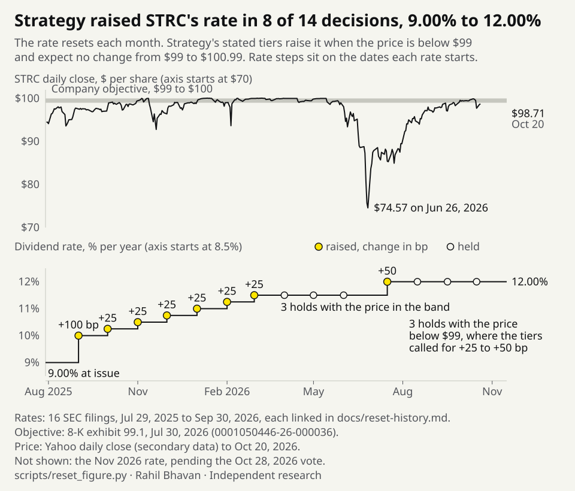

# STRC rate controller: 14 filed STRC rate decisions charted against price, with replay and stress tools

Strategy changes the dividend rate on its STRC shares each month to keep their price near $100; this project charts every change from the SEC filings and tests simple rules and stress cases against them.

[](https://github.com/RahilBhavan/strc-rate-controller/actions/workflows/ci.yml)

STRC is Strategy's Variable Rate Series A Perpetual Stretch Preferred Stock. It has no maturity, and management resets its dividend rate each month at its discretion. Strategy's stated objective is for STRC to trade at $99 to $100 ([8-K exhibit 99.1, July 30, 2026](https://www.sec.gov/Archives/edgar/data/1050446/000105044626000036/mstr-20260730x8kxex991.htm)). Its published guidance ties each reset to STRC's volume-weighted average price (VWAP) for the month:

- Below $95: raise the rate by 50 bp or more.
- $95 to $98.99: raise it by 25 bp (or more).
- $99 to $100.99: no change expected, though management may move 25 bp either way.
- $101 and above: cut it by 25 bp, or more if one-month term SOFR fell.

The guidance is a stated intention, not a contract term ([8-K of February 5, 2026](https://www.sec.gov/Archives/edgar/data/1050446/000105044626000012/mstr-20260205.htm); before then the window was the five trading days before month-end). The certificate of designations does not cap increases. It limits each cut to 25 bp plus any decline in one-month SOFR and keeps the rate at or above that SOFR. The chart puts every filed rate next to the price the guidance watches.



<!-- reset-table:start -->
<details>
<summary>Every reset in the chart, with its filing</summary>

| Notice | Rate period | Rate | Change | Measured price | Stated tier | SEC filing |
|---|---|--:|---|--:|---|---|
| 2025-07-29 | 2025-07-29 to 2025-08-31 | 9.00% | at issue | n/a | n/a | [0001193125-25-167987](https://www.sec.gov/Archives/edgar/data/1050446/000119312525167987/d43815dex31.htm) |
| 2025-08-31 | 2025-09-01 to 2025-09-30 | 10.00% | +100 bp | $95.78 (5-day) | +25 bp | [0001193125-25-193487](https://www.sec.gov/Archives/edgar/data/1050446/000119312525193487/d80677d8k.htm) |
| 2025-09-30 | 2025-10-01 to 2025-10-31 | 10.25% | +25 bp | $97.20 (5-day) | +25 bp | [0001193125-25-225038](https://www.sec.gov/Archives/edgar/data/1050446/000119312525225038/d939712d8k.htm) |
| 2025-10-30 | 2025-11-01 to 2025-11-30 | 10.50% | +25 bp | $98.65 (5-day) | +25 bp | [0001193125-25-258690](https://www.sec.gov/Archives/edgar/data/1050446/000119312525258690/mstr-20251030.htm) |
| 2025-11-30 | 2025-12-01 to 2025-12-31 | 10.75% | +25 bp | $94.69 (5-day) | +50 bp | [0001193125-25-303157](https://www.sec.gov/Archives/edgar/data/1050446/000119312525303157/d69948d8k.htm) |
| 2025-12-31 | 2026-01-01 to 2026-01-31 | 11.00% | +25 bp | $98.92 (5-day) | +25 bp | [0001193125-26-000264](https://www.sec.gov/Archives/edgar/data/1050446/000119312526000264/mstr-20251117.htm) |
| 2026-01-31 | 2026-02-01 to 2026-02-28 | 11.25% | +25 bp | $99.01 (5-day) | no change | [0001193125-26-032731](https://www.sec.gov/Archives/edgar/data/1050446/000119312526032731/mstr-20260131.htm) |
| 2026-02-28 | 2026-03-01 to 2026-03-31 | 11.50% | +25 bp | $98.56 (month) | +25 bp | [0001193125-26-084264](https://www.sec.gov/Archives/edgar/data/1050446/000119312526084264/mstr-20260228.htm) |
| 2026-03-31 | 2026-04-01 to 2026-04-30 | 11.50% | held | $99.94 (month) | no change | [0001193125-26-135765](https://www.sec.gov/Archives/edgar/data/1050446/000119312526135765/mstr-20250902.htm) |
| 2026-04-30 | 2026-05-01 to 2026-05-31 | 11.50% | held | $99.77 (month) | no change | [0001193125-26-199155](https://www.sec.gov/Archives/edgar/data/1050446/000119312526199155/mstr-20250902.htm) |
| 2026-05-31 | 2026-06-01 to 2026-06-30 | 11.50% | held | $99.59 (month) | no change | [0001193125-26-249768](https://www.sec.gov/Archives/edgar/data/1050446/000119312526249768/mstr-20260530.htm) |
| 2026-06-15 | 2026-07-01 to 2026-07-15 | 11.50% | carried, not a decision | n/a | n/a | [0001193125-26-270366](https://www.sec.gov/Archives/edgar/data/1050446/000119312526270366/d144149d8k.htm) |
| 2026-06-29 | 2026-07-16 to 2026-08-15 | 12.00% | +50 bp | $88.71 (month) | +50 bp | [0001193125-26-286871](https://www.sec.gov/Archives/edgar/data/1050446/000119312526286871/mstr-20260629.htm) |
| 2026-07-31 | 2026-08-16 to 2026-09-15 | 12.00% | held | $87.53 (month) | +50 bp | [0001193125-26-329565](https://www.sec.gov/Archives/edgar/data/1050446/000119312526329565/mstr-20260803.htm) |
| 2026-08-31 | 2026-09-16 to 2026-10-15 | 12.00% | held | $95.45 (month) | +25 bp | [0001193125-26-377583](https://www.sec.gov/Archives/edgar/data/1050446/000119312526377583/mstr-20260831.htm) |
| 2026-09-30 | 2026-10-16 to 2026-11-15 | 12.00% | held | $98.31 (month) | +25 bp | [0001193125-26-409863](https://www.sec.gov/Archives/edgar/data/1050446/000119312526409863/mstr-20260930.htm) |
| 2026-10-15 | 2026-11-01 to 2026-11-30 | 12.00% | pending vote, excluded | n/a | n/a | [0001193125-26-423400](https://www.sec.gov/Archives/edgar/data/1050446/000119312526423400/mstr-20261015.htm) |

Measured price is a daily typical-price VWAP proxy over the window the stated tiers name. Stated tier is the minimum change those tiers recommend. The $99 to $100 objective is from [8-K exhibit 99.1, 0001050446-26-000036](https://www.sec.gov/Archives/edgar/data/1050446/000105044626000036/mstr-20260730x8kxex991.htm). Generated by `scripts/reset_figure.py`.

</details>
<!-- reset-table:end -->

## Results

All figures use the frozen snapshot: filings to October 21, 2026 and market bars to October 20, 2026.

- **Reset history.** Of 14 rate decisions, Strategy raised the rate 8 times, from 9.00% to 12.00%, and held it 6 times. The 3 holds since August 2026 came with the measured price below $99, where the stated tiers call for a 25 to 50 bp rise (`scripts/reset_figure.py`, table above).
- **No rule predicts the next reset.** The last 3 decisions are the holdout. Always holding scored 0 bp mean absolute error and the stated-tier rule 33.33 bp (`results/fit.json`, `results/evaluation.json`). Three decisions prove little. The [chronological evaluation](docs/evaluation.md) has dated ledgers for ten policies and simple baselines.
- **Stress replay.** The table below asks what rate STRC would need if BTC fell and stayed down.

<!-- stress-table:start -->
**BTC -40% answer.** If BTC falls 40% from $84,048 to $50,429 and stays there, the log-spread model needs a 15.155% dividend rate for STRC to price at $100 (13.626% to 16.684% across assumed slope multipliers 0.5x to 1.5x). The modeled price falls from $99.20 to $79.18, and the stated tiers take 8 months to lift the rate from 12.00% until the price is back in the $99 band. At the required rate, dividends on $8.60bn notional cost $1,303m a year. These are assumed stresses, not forecasts.

| BTC move | Spread form | Required rate, 1x slope | Range, 0.5x to 1.5x slope | Price after shock | Months to $99 band | Annual dividend cost at required rate |
|---|---|--:|--:|--:|--:|--:|
| -20% | log | 13.433% | 12.765% to 14.101% | $89.33 | 4 | $1,155m |
| -20% | distance | 13.592% | 12.845% to 14.340% | $88.28 | 4 | $1,169m |
| -40% | log | 15.155% | 13.626% to 16.684% | $79.18 | 8 | $1,303m |
| -40% | distance | 16.983% | 14.540% to 19.426% | $70.66 | 11 | $1,460m |
| -60% | log | 17.582% | 14.839% to 20.325% | $68.25 | 12 | $1,512m |
| -60% | distance | 32.088% | 22.092% to 42.083% | $37.40 | more than 24 | $2,759m |

Source: `results/scenarios.json` (`btc_shock_sensitivity`), stated-tier policy, 24-month horizon, SOFR 3.88% held flat, cutoff 2026-10-21. Generated by `scripts/readme_table.py`.
<!-- stress-table:end -->

`results/scenarios.json` also has spread shocks and other response policies.

## How it works

`strc/history.py` re-extracts each rate from its cached filing; `rules.py` separates contract limits from the stated tiers; `features.py` builds price and rate proxies; `fit.py` and `evaluation.py` score policies; `credit.py` and `sim.py` generate assumed spread and rate paths. All inputs come from a frozen, hash-verified local cache.

Terms used in the outputs:

- **Stated-tier proxy** (`framework` policy): the tiers above read as a rule. The real decision stays discretionary.
- **mNAV**: Strategy's company-defined enterprise value divided by the value of its BTC holdings. The model uses a proxy: Strategy's own mNAV on 2026-10-21, scaled back in time by the MSTR/BTC price ratio.
- **Coverage price** (`b_star`, also written as `coverage_btc_price_usd`): the BTC price at which Strategy's BTC holdings equal its debt plus preferred notional. Below it, the `distance` form has no finite required rate.
- **Spread form**: how the fitted credit spread depends on BTC. `log` uses log(BTC / coverage price); `distance` grows without limit as BTC approaches the coverage price.
- **Assumed slope multiplier**: the fitted spread slope multiplied by 0.5, 1 or 1.5 to show how much the answer depends on that one estimate.
- **$101 simulated ceiling**: the model caps STRC's price at $101, the optional redemption price. Real prices can trade above it.

## Run it

Python 3.12+; tested with Python 3.14.7. Standard library only, no credentials. From this repository:

```bash
python3 scripts/snapshot.py
python3 scripts/verify_sources.py
python3 -m unittest discover -s tests -v
python3 scripts/run_all.py
python3 scripts/evaluate_policies.py --policy framework
python3 scripts/reset_figure.py --check
python3 scripts/result_figure.py --check
python3 scripts/readme_table.py --check
```

Observed: **45 tests passed**. Generated CSV/JSON are local ignored files. `python3 scripts/validate.py` verifies sources, runs the tests and compares two demo runs; repeating the demo reproduces seven output hashes. Optional fetch helpers need `SEC_USER_AGENT` with a contact email for EDGAR and may change the sample.

To try your own stress without rewriting any files, pass `--btc-shock` (percent, -95 to 400) and/or `--spread-shock` (basis points, -500 to 2000):

```bash
python3 scripts/run_all.py --btc-shock -40 --spread-shock 200
```

```text
Assumed stress: BTC -40% ($84,048 to $50,429), spread +200 bp, stated-tier policy, 24 months.
Start: rate 12.00%, SOFR 3.88%, market data through 2026-10-20.
spread form slope x required rate   price months to $99  annual cost
log             0.5       15.626%   76.80             8    1,344 $m
log               1       17.155%   69.95            11    1,475 $m
log             1.5       18.684%   64.23            14    1,606 $m
distance        0.5       16.540%   72.55            10    1,422 $m
distance          1       18.983%   63.22            15    1,632 $m
distance        1.5       21.426%   56.01            20    1,842 $m
Assumptions, not forecasts: fitted spread slopes, fixed notional, $101 price ceiling, discretionary resets.
```

## Repository layout

- `strc/`: parsing, bounds, fitting and simulation.
- `scripts/`: restore, integrity checks, figures, optional fetching and demo.
- `snapshot/`: compressed frozen-source parts and archive hash.
- `provenance/`: readable source URL/date/hash inventories.
- `tests/`: source, replay, figure, negative-input and stress checks.
- `docs/`: scope, sources, review and verification evidence.
- `assets/`: reproducible figures (`resets.svg`, `holdout.svg`).

## Documentation

- [Public design system](DESIGN.md): Rahil Design 3.3.0, shared tokens and visual review rules.
- [Scope and acceptance](docs/spec.md): local v1 contract.
- [Chronological evaluation](docs/evaluation.md): dated ledgers, simple baselines, losing cases and a five-minute example.
- [Methodology](docs/methodology.md): fitting, lookahead limitations and stress assumptions.
- [Sources](docs/sources.md): source coverage and verification.
- [Validation](docs/validation.md): exact checks and reproducibility evidence.
- [Correctness review](docs/review.md): proven failures, fixes and remaining limits.
- [Publication receipt](docs/publication.md): remote verification evidence.

## Sources

The snapshot contains 385 attributed response bodies, including SEC filings, Strategy KPI responses, NY Fed SOFR and Yahoo daily bars. Yahoo is secondary market data. See the [source notes](docs/sources.md) and `provenance/`. Dates of financial observations and UTC fetches are distinct.

## Scope and limits

- Independent research; no affiliation with Strategy. No investment recommendations or execution.
- Each reset is discretionary, not a price-to-rate formula. The November 2026 rate depends on the October 28, 2026 daily-dividend vote and is excluded.
- Measured price is a daily typical-price VWAP proxy; overnight SOFR stands in for licensed term SOFR; the mNAV proxy is scaled with hindsight. The policy comparison is retrospective, with models and split chosen after seeing the history.
- Stress results assume a fixed capital structure, perpetual pricing and the $101 ceiling. There is no default, liquidity or causal model.
- Optional fetch helpers are not a rolling update pipeline; the model loads the frozen snapshot.
- Cached third-party bodies are attributed research inputs, with no blanket redistribution license asserted. See [source rights](docs/sources.md).

## License

[MIT](LICENSE). The license covers this project's code only. Third-party source documents and data keep their owners' rights.

Part of [Rahil Bhavan's projects](https://github.com/RahilBhavan).
