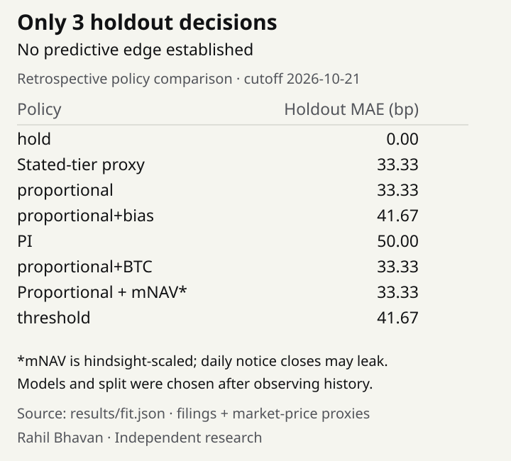

# STRC rate controller: replay discretionary resets and stress assumed responses

[](https://github.com/RahilBhavan/strc-rate-controller/actions/workflows/ci.yml)



A Python research tool that extracts STRC reset history from filings, compares descriptive policies, and simulates assumed BTC/spread shocks. It separates filed reduction constraints from management's discretionary decisions. Financial cutoff: October 21, 2026; market bars end October 20.

## Results

- Fourteen unconditional rate decisions, eleven training and three holdout observations, plus eight-step expanding replay and replay-start sensitivity (`results/fit.json`). The hold baseline has 0 basis-point holdout MAE; the stated-tier proxy has 33.33 basis points. A three-observation holdout proves little.
- `results/evaluation.json` adds ten-policy dated ledgers, prior-change/median baselines, paired losses against hold, raw/rounded error and omit-one-date sensitivity. See the [reproducible example](docs/evaluation.md).
- The source history includes 17 announcements; the contingent November daily declaration remains labeled and excluded from fitting (`data/derived/announcements.csv`).
- BTC -40% scenarios include two spread forms, three assumed slope multipliers and several discretionary response policies (`results/scenarios.json`). They are stress assumptions, not observed outcomes or default probabilities.

## How it works

`strc/history.py` extracts filed rates; `rules.py` separates restrictions from guidance; `features.py` builds price/rate proxies; `fit.py` scores policies; `credit.py` and `sim.py` generate assumed spread and rate paths. All demo inputs come from a frozen, hash-verified local cache.

## Run it

Python 3.12+; tested with Python 3.14.7. Standard library only. From this repository:

```bash
python3 scripts/snapshot.py
python3 scripts/verify_sources.py
python3 -m unittest discover -s tests -v
python3 scripts/run_all.py
python3 scripts/evaluate_policies.py --policy framework
python3 scripts/result_figure.py --check
```

Observed: **34 tests passed**. No credentials or installation are needed for this offline demo. Generated CSV/JSON are local ignored files. Run `python3 scripts/validate.py` to verify sources, run tests and compare two demo runs. Repeating the demo reproduces seven output hashes. Optional fetch helpers require `SEC_USER_AGENT` with a contact email for EDGAR and may change the sample.

## Repository layout

- `strc/`: parsing, bounds, fitting and simulation.
- `scripts/`: restore, integrity checks, optional fetching and demo.
- `snapshot/`: compressed frozen-source parts and archive hash.
- `provenance/`: readable source URL/date/hash inventories.
- `tests/`: source, replay, negative-input and stress checks.
- `docs/`: scope, sources, review and verification evidence.
- `assets/`: reproducible result figure.

## Documentation

- [Public design system](DESIGN.md): Rahil Design 3.3.0, shared tokens and visual review rules.

- [Scope and acceptance](docs/spec.md): local v1 contract.
- [Chronological evaluation](docs/evaluation.md): dated ledgers, simple baselines, losing cases and a five-minute example.
- [Methodology](docs/methodology.md): fitting, lookahead limitations and stress assumptions.
- [Sources](docs/sources.md): source coverage and verification.
- [Validation](docs/validation.md): exact checks and reproducibility evidence.
- [Correctness review](docs/review.md): proven failures, fixes and remaining limits.
- [Publication receipt](docs/publication.md): remote verification evidence.

## Sources

The snapshot contains 385 attributed response bodies, including SEC filings, Strategy KPI responses, NY Fed SOFR and Yahoo daily bars. Yahoo is secondary market data. See the [source notes](docs/sources.md) and `provenance/`. Dates of financial observations and UTC fetches are distinct.

## Scope and limits

- Independent research; no affiliation with Strategy. No investment recommendations or execution.
- The reset is discretionary, never a mandatory price-to-rate formula. The October 28 daily-dividend vote is pending at the cutoff.
- Overnight SOFR substitutes for licensed term SOFR; daily typical-price VWAP and hindsight-scaled mNAV are rough proxies. This is not a contractual compliance certificate or a prospective forecasting validation.
- Fixed capital structure, perpetual pricing and the $101 simulated ceiling are assumptions. No causal identification, redemption guarantee, liquidity or default model.
- Optional fetch helpers are not a rolling update pipeline; the model intentionally loads the frozen snapshot.
- Cached third-party bodies are attributed research inputs, with no blanket redistribution license asserted. See [source rights](docs/sources.md).

## License

No license file yet. Third-party source documents/data retain their owners' rights.

Part of [Rahil Bhavan's projects](https://github.com/RahilBhavan).
